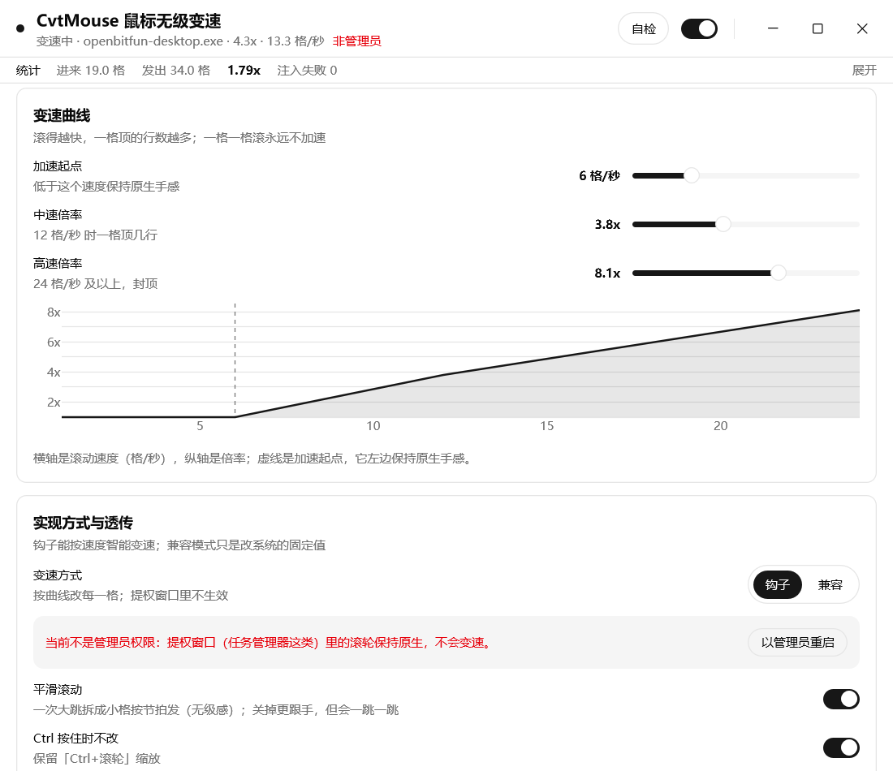
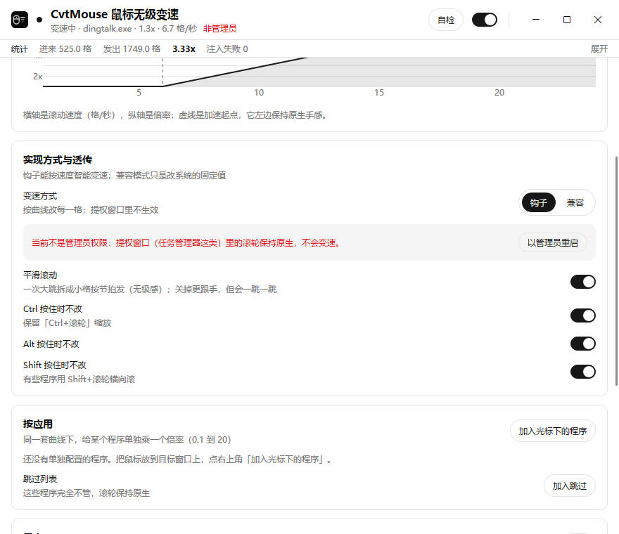
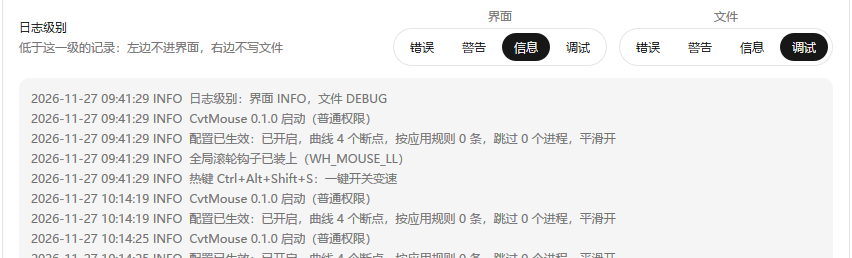

# CvtMouse 鼠标无级变速

鼠标的无级变速：按操作速度自动放大，慢的还是原生手感，越快越跟得上。

| 部分 | 状态 |
| --- | --- |
| **滚轮** | 已实现：慢滚一格一行，越滚越快，倍率跟着曲线上去 |
| **指针**（光标移动） | 计划中：同样按曲线无级变速 |

不绑定品牌和型号——只要是一只标准 HID 鼠标（有线、2.4G、蓝牙都算），装上去就生效。

用 Rust 写核心（Win32 低级鼠标钩子 + 注入），界面用 [nsh](https://github.com/longbridge/nsh)（TSX）。

## 界面





日志级别分「界面」和「文件」两档、各四档（错误 / 警告 / 信息 / 调试）：低于选定级别的
记录左边不进界面、右边不写文件。平时界面 `信息`、文件 `调试`；要排查就把
`%APPDATA%\CvtMouse\logs` 下当天的文件发出来。



## 为什么滚轮必须走钩子

滚轮一格是鼠标固件写死的 HID 报文（`±120` 个 wheel 单位），而「一格滚几行」是**主机侧**
解释出来的。所以想变速只有两条路：

1. 改系统那个全局固定值 `SPI_SETWHEELSCROLLLINES`——所有程序同一个值，不可能「按速度变」。
2. 在输入链路上把事件拦下来，自己换算再发回去——本项目的做法（`WH_MOUSE_LL` +
   `SendInput` 重注入）。

设备协议那条路（找厂商自定义 HID 集合改固件参数）对绝大多数鼠标不存在：它们只暴露
标准 mouse/consumer 集合，没有可写的厂商集合。所以变速只能做在主机侧，好处是**换鼠标、
换接口都不用改代码**。

## 两种模式

| 模式 | 做什么 | 适合 |
| --- | --- | --- |
| **钩子 + 重注入**（默认） | 按速度曲线改每一格，能按应用分别设倍率 | 想要智能变速 |
| **兼容模式** | 只改系统的「每格滚几行」，不装钩子 | 只想整体快一点，或钩子被安全软件拦了 |

兼容模式会记住原值，切回钩子模式时自动还原。

## 界面能调什么

- **速度曲线**：三个滑块对应曲线上的三个点（起点、中速、高速），断点是「格/秒 → 倍率」，
  中间线性插值，两头取端点值。默认 `[(0,1) (6,1) (12,2.5) (24,5)]`：单滚一格不加速，
  快滚到 24 格/秒时 5 倍。
- **平滑滚动**：一次大跳拆成小格、每 8ms 发一格（积压多了就一拍多发几格追上）。这是
  「无级」手感的来源；关掉更跟手，但会一跳一跳。
- **Ctrl / Alt / Shift 按住时不改**：保留 `Ctrl+滚轮` 缩放、`Shift+滚轮` 横向滚。
- **按应用倍率**、**跳过名单**：某些程序（游戏、远程桌面）完全不接管。
- **热键**：默认 `Ctrl+Alt+S` 一键开关；被占用时依次退到 `Ctrl + Alt + Shift + S`、`Ctrl+Alt+F12`。

## 再点一次图标，不会再开一个

`nsh.json` 里 `"singleInstance": true`：第二次启动直接退出（连窗口都不建），把这次启动
交给已经在跑的那个实例；那个实例听到 `reopen` / `secondInstance` 就把窗口叫回来并置顶。
所以「以为程序关了、又点一次图标」的结果是托盘里的窗口回来——不会变成两个进程、两个
钩子抢同一只鼠标。

## 配置

`%APPDATA%\CvtMouse\config.json`，字段名 camelCase（磁盘格式 = 界面草稿格式）：

| 字段 | 含义 |
| --- | --- |
| `enabled` | 总开关 |
| `mode` | `hook` / `system` |
| `curve` | 断点 `[[格/秒, 倍率], …]` |
| `apps` | 按进程覆盖倍率，键是小写 exe 名 |
| `skip` | 完全不接管的进程 |
| `passCtrl` `passAlt` `passShift` | 按住这些键时原样放行 |
| `smooth` | 平滑输出（按节拍发，见上） |
| `systemLines` / `originalLines` | 兼容模式的每格行数 / 进兼容模式前的原值 |

日志：`%APPDATA%\CvtMouse\logs\cvtmouse-YYYY-MM-DD.log`，每行都带完整时间戳。

## 怎么读「统计」卡

| 指标 | 说明 |
| --- | --- |
| 进来 / 发给应用 | 都是 **wheel 单位**（120 = 一格），显示成格时保留一位小数 |
| 加速比 | 发给应用 ÷ 进来 |
| 原样放行 | 倍率恰好 1、按了修饰键、在跳过名单、提权窗口、认不出程序——这些都直接交给系统 |
| 注入失败 | `SendInput` 被系统拒掉的次数，正常应为 0；连续 3 次会自动关掉变速 |
| 最近一格原始值 | 标准一格是 `±120`；不是 `±120` 说明鼠标在送细粒度值（触控板、高分辨率滚轮） |

快滚时（速度 ≥ 8 格/秒）或收到非标准值时，日志里会留一行
`滚轮 原始=120 速度=17/s 倍率=7.48 输出=960 目标=xxx.exe`，每次运行最多 400 行。
**这是排查「为什么没动」的第一手证据**：有这行说明事件进来了、也算出了要发多少；
没有这行说明事件根本没到钩子（鼠标/BLE 丢报文，或者钩子没装上）。

## 已知限制

- **提权窗口**：普通权限运行时，注入会被 UIPI 丢掉。所以这类窗口一律原样放行（滚轮正常，
  但不加速）。要加速就「以管理员身份重启」。
- **认不出的程序**（受保护进程）同样放行，理由同上。
- **蓝牙鼠标快甩可能丢报文**：这是链路层的限制，主机侧收不到就无从放大。
- 安全软件（如某些国产 HIPS）可能拦低级鼠标钩子或注入。钩子装不上时界面会说明。

## 开发

```sh
nsh run          # 起开发宿主（TSX 改动热更新，Rust 改动重建并重启）
nsh check        # cargo check + 入口与 ui/ 的类型检查
nsh test         # cargo test + ui/ 下的界面测试（无窗口）
nsh build        # 只出 bundle（.nsh/out），不打包
.\package.ps1    # 打 Windows 包（exe + zip）、把 nsh/ 内嵌进 exe、压到最小
```

工具链是 nsh 0.7.2：`Cargo.toml` 的 `nsh-core` / `nsh-base` 必须和它对齐，CI 里也钉着
同一个版本（见下面「发布」一节）。

### 打包体积

包里的 99% 是 **nsh 的运行时 runner**（我们自己的东西只有 bundle 29KB + 图标 58KB），
而 runner 是 nsh 用 cargo 在它自己的 workspace 里编的，所以本仓库 `Cargo.toml` 的
`[profile.release]` 对它无效（cargo 会忽略成员 crate 的 profile）——只能用 cargo 的
profile 环境变量，`package.ps1` 就是把这几个变量设好再调 `nsh package`：

| 配置 | exe | zip |
| --- | --- | --- |
| 不设（`nsh package` 直跑） | 50.09 MB | 19.06 MB |
| `-Fast`：`opt-level=s` + `lto=thin` | 35.07 MB | 13.83 MB |
| `opt-level=z` + `lto=fat`（0.1.3 及以前） | 30.97 MB | 13.03 MB |
| 上面那组 + `panic=abort` | 19.75 MB | 9.81 MB |
| 再去掉 `nsh-base` 依赖 | 16.12 MB | 7.75 MB |
| **上面那组 + nightly `build-std`（0.1.4）** | **15.16 MB** | **7.40 MB** |

0.1.4 的发布包还多挂一份 `.7z`：同一个 exe，LZMA2 压出来 **4.76 MB**（zip 是 deflate，
7.40 MB）——下载量直接砍三分一，零风险，`package.ps1` 和 CI 都会顺手出一份。

`lto=fat` + `codegen-units=1` + `strip=symbols` 一直开着。四步压下来：

| 动作 | runner exe | 省 |
| --- | --- | --- |
| 起点（0.1.3 发布版，CI） | 32,572,284 B | — |
| `panic=abort` | 20,557,824 B | −11.8 MB |
| 去掉没人用的 `nsh-base` | 16,756,224 B | −3.63 MB |
| nightly `-Zbuild-std=std,panic_abort` + `-Zlocation-detail=none` | 15,751,168 B | −0.96 MB |

最终成品 `15,900,523 B`（含 89,939 B 内嵌资源），zip `7,757,438 B`，7z `4,990,898 B`。

代价：nsh 运行时原本靠 `catch_unwind` 把 Rust panic 拦下来转成错误（`nsh-core/main_thread.rs`、
`nsh-js/classes.rs`、`nsh-engine/host_channel.rs` 一共 26 处），abort 之后 Rust 侧一 panic
进程就退出。**panic hook 仍会跑**（nsh-engine/logging.rs 里 `set_hook`），日志写得出，但
`-Zlocation-detail=none` 把 panic 信息里的文件名和行号去掉了（反正 abort 后也没回溯）。
要排查 panic 的话，把 `package.ps1` 里 `RUSTFLAGS` 那行删掉重打一版就能拿回位置。

`opt-level` 用 `z` 而不是 `s`：同一份代码只差这一项，`z` 的 runner 是 19.61 MB，`s` 是
22.99 MB（差 3.4 MB）——既然一切为了体积，就用 `z`。

`build-std` 是 cargo 的参数，`RUSTFLAGS` 里塞不进去（rustc 报 unknown unstable option），
nsh 也不会替我们传，所以 `package.ps1` 走 cargo 的 unstable 配置环境变量
`CARGO_UNSTABLE_BUILD_STD=std,panic_abort` + `RUSTUP_TOOLCHAIN=nightly`。它只影响这一次
打包；别人 `cargo build` / `nsh dev` 用 stable 照样能编。代价是打包机要装
`rustup toolchain install nightly --profile minimal --component rust-src`（脚本里有预检，
缺了会直接报这句命令）。

编译时间：换档后 LTO 全量重编约 2~7 分钟（改一行也要重编）；代码没动时再跑只要 2 秒。

### runner 的 feature 怎么定的

runner 里哪些模块编进去，是 **nsh 自己按「这个 app 实际 import / link 了什么」挑的**，
`nsh package -v` 会把决定逐条打出来（实测 0.7.2）：

```text
keep `js`: the app has a JS bundle
keep `net`: `fetch` and remote images depend on data, not imports
keep `svg`: an image's format depends on data, not imports
keep `plot`: the app links `nsh_part_plot`
leave out `shader` `editor` `rich-editor` `term` `emoji-picker` `highlight` `math`
          `zlib` `crypto` `websocket` `updater` `webview` `sound` `media`
```

想改这个判断本身是改不动的，三条都试过：

* 宿主 crate `.nsh/rust/windows-app/Cargo.toml` 里确实有一条全量的 `default = [...]`，但
  每次 `nsh package` 都会把它重写回去（改完再跑，4 秒后就被覆盖）；
* `nsh.json` 的 `"features"` 说的是 **app 自己 crate 的** Cargo feature，不是 runner 的
  （nsh 自己的帮助原文：*The crate's Cargo features to turn on*）。拿一个不存在的 feature
  名做探针塞进去，`nsh package -v` 的 keep/leave 列表一字未变，也不报错；
* `nsh package` 没有 `--features`，也没有相关的环境变量。

**但 `leave out` 会被我们自己的依赖悄悄抵消掉。** 这里踩过一次：`Cargo.toml` 里写着
`nsh-base = "0.7.2"`（默认特性 = `editor` / `highlight` / `plot` / `rich-editor` / `term`），
而 `src/` 里一次都没用到 `nsh_base`。cargo 的 feature 统一让 nsh 的 `leave out highlight`
失效，`syntect` + `oniguruma` + `ropey` + `vte` 全被链进 exe（成品里 `onig` 有 137 处字符串）。

```text
$ cargo tree -i syntect
syntect v5.3.0
├── nsh-base v0.7.2
│   ├── cvtmouse v0.1.4 (D:\dev\project\i\rust\CvtMouse)   ← 就是这行
│   └── nsh-app-cvtmouse-windows-app v0.0.0
```

把那行删掉（宿主 crate 自己声明的是 `default-features = false`），`syntect` / `onig` /
`ropey` / `vte` / `curve25519-dalek` 全部从依赖图消失：

| | runner exe |
| --- | --- |
| 带 `nsh-base`（默认特性） | 20,557,824 B |
| 删掉 `nsh-base` | **16,756,224 B（−3.63 MB）** |

教训：**自己 crate 的依赖特性也会决定 runner 里有什么**，删无用依赖和关默认特性都要做。

### 还能压的（都量过了，0.1.4 之后只剩这些）

| 手段 | 收益 | 代价 | 结论 |
| --- | --- | --- | --- |
| `panic=abort` | −11.2 MB | panic 不再被拦，但 hook 仍写日志 | **已做** |
| 去掉 `nsh-base` | −3.63 MB | 无（本来就没用到） | **已做** |
| nightly `-Zbuild-std=std,panic_abort` + `-Zlocation-detail=none` | −0.96 MB | 打包机要 nightly + `rust-src`，panic 没有文件名行号 | **已做** |
| 发布包再挂一份 7z（LZMA2 `-mx9`） | zip 7.40 → **4.76 MB** | 无（zip 照旧，两个都挂） | **已做** |
| 关掉 `svg` | −2.03 MB | nsh 判断不了数据驱动用法，关不掉 | 等上游 |
| 关掉 `net` | −416 KB | 同上 | 等上游 |
| `panic="immediate-abort"` | 几百 KB | panic 完全不格式化，连日志都没有 | 不建议 |
| UPX | 能压到 7 MB 级 | 杀软误报、每次启动要解压 | 不建议 |

`wgpu` 不在上面这张单子里：它在 `nsh-engine` 里是 `optional = true`，由 `shader` feature
决定，而 runner 的判断是 `leave out shader`，所以打包产物里**根本没有 wgpu**（按打包用的
feature 集合跑 `cargo tree -i wgpu` 会直接报 `package ID specification wgpu did not match
any packages`；扫成品也只找到 `Devanagari` 这类文字名里的 `naga`，没有 `naga::` 路径）。
留一个对照：故意带上 `shader` 编一次，runner 是 23,275,008 B（+2.59 MB），里面 `wgpu` 202 处、
`naga::` 210 处、`D3D12` 35 处、`Vulkan` 19 处——所以它在不在，一眼就能看出来。

### exe 属性页里的版本

`nsh package` 会把它的 runner 复制成 `CvtMouse.exe`、把图标补进去，但**不写版本资源**
（`nsh.exe` 里连 `VS_VERSION_INFO` 这个字符串都没有），所以属性页的「文件版本」本来是空的。
版本信息只能由我们自己的 crate 带进去：`app.rc` 写一份 VERSIONINFO，`build.rs` 把里面的
`@VERSION@` / `@VERSION_QUAD@` 换成 `Cargo.toml` 的 `version`（版本号只有一处真相，发版
流程里不用像别的项目那样 sed 改 app.rc），`embed-resource` 编成资源段随 crate 链进 exe。

实测（`package.ps1` 那档产物）：`FileVersion` / `ProductVersion` 就是 `Cargo.toml` 的
`version`（0.1.4 打出来是 `0.1.4`），另有 `ProductName CvtMouse` /
`FileDescription CvtMouse 鼠标无级变速` / `OriginalFilename CvtMouse.exe`。

### 单文件产物：`nsh/` 内嵌进 exe

用户拿到的只有一个 `CvtMouse.exe`，**没有 `nsh\` 目录**。做法是打包时把整个 `nsh/`
按 `[u16 名字长度][名字 UTF-8][u32 数据长度][数据]` 拼成 payload 挂在 exe 尾巴上，末尾
再跟 `[u64 payload 长度][16 字节魔数]`；程序自己在 `.CRT$XCU`
（CRT 的初始化段，比 `main` 早）把 payload 解到
`%LOCALAPPDATA%\CvtMouse\runtime\<payload 摘要>\`，然后把 `NSH_APP_DIR` 指过去——runner
就当那是它的 `nsh/`。解包逻辑在 `src/infra/embed.rs`，挂尾巴在 `package.ps1`。

为什么要绕这一圈：nsh 0.7.2 的 runner 里，应用目录只有两个来源
（`current_exe().parent()/nsh` 或 `NSH_APP_DIR`），`AssetBase` 只有「目录」和「HTTP」
两种（没有内存态），`nsh package` 也没有内嵌开关。不改 nsh 又要单文件，就只能让 exe
自己把资源写出来。

三个已知代价（都不影响使用，写下来免得以后踩）：

* 第一次启动要解 90 KB 到 `%LOCALAPPDATA%`：实测冷启动到窗口出现 317 ms，第二次
  283 ms，且**第二次不写盘**（目录按 payload 摘要分，命中直接复用）；
* 设了 `NSH_APP_DIR` 之后 nsh 把自己当「开发运行」（`nsh-windows-app` 里
  `developing = NSH_APP_DIR.is_some()`）：login item 不注册、nsh 自己那套日志过滤器放
  宽。本程序不注册开机自启、日志走自己写的那份，所以这两条都碰不到；
* 缓存目录不自动清理（每个版本约 90 KB），删掉会自动重建。`nsh run` / `nsh test` 里
  exe 尾巴上没有魔数，这段逻辑看一眼就返回，开发流程一个字不变。

目录按「谁碰什么」分开：改算法不用碰系统接口，改界面不用碰 Win32：

```text
App.tsx                 入口，只 mount（必须在仓库根：nsh 认 `nsh.json` 里的 `"rust": "."`，
                        而 `nsh.json` 必须和入口同级——`nsh package` 的说明原文是
                        「Metadata comes from `nsh.json` next to the entry」）
app.rc                  Windows 资源脚本：exe 属性页里的产品名 / 说明 / 版本（版本是占位符）
build.rs                把 app.rc 的占位符换成 Cargo.toml 的 version，再编进资源段
src/                    Rust 后端
├─ lib.rs               只有注册（nsh 要求 `#[native_module]` 在 crate 根）
├─ api/                 nsh 边界：Backend 的每个方法，JSON 文本进出
├─ runtime/             编排：把 core 的判断接到 Windows 输入链路上
│  ├─ mod.rs            全局引擎、线程生命周期、把系统信息填成 Env 交给 Policy
│  ├─ hook.rs           钩子线程：WH_MOUSE_LL 回调、热键、消息循环
│  └─ pump.rs           注入线程：按 8ms 节拍把积压的格数一格一格发出去
├─ core/                核心实现：纯逻辑，不碰 Win32、不碰文件系统
│  ├─ policy.rs         要不要改、改多少（Env/Act/Policy，有单测）
│  ├─ stats.rs          界面读的那些计数（观测数据，不参与决策）
│  ├─ curve.rs          曲线插值、速度计、累加器（有单测）
│  ├─ pacing.rs         每拍发几格（输出侧节流，有单测）
│  └─ config.rs         配置结构、默认值、校验
├─ sys/                 系统调用：只有这里能 use windows_sys
│  ├─ win32.rs          权限、提权重启、光标下窗口、系统行数
│  └─ clock.rs          时间戳（SYSTEMTIME）与单调毫秒
└─ infra/               落地：只有这里写文件
   ├─ log.rs            内存环形缓冲 + 500ms 落盘（钩子回调里禁止 IO）
   ├─ store.rs          config.json 的路径与读写
   └─ embed.rs          exe 尾巴上的 nsh/ 解包（进程起来的第一件事）
ui/                     TSX 界面
├─ Settings.tsx         整页设置（顶栏兼任标题栏和拖动区，四边四角拖边也在里面）
├─ format.ts            倍率/速度的文字
├─ logo.svg             图标矢量原图（界面左上角直接 import，`assets/icon.png` 由它导出）
├─ components/ui.tsx    卡片、一行设置、读数（只有布局，没有控件）
└─ lib/                外部依赖
   ├─ api.ts            唯一 import cvtmouse/native 的地方
   └─ desktop.ts        托盘图标 + 关窗收进托盘
assets/                 打包与展示素材（前端不 import 这里的东西，原因见下）
├─ icon.png             1024×1024，`nsh.json` 的 `"icon"` 指它（`nsh package` 用）
└─ screenshots/         README 里的界面截图（中英文各一套时按 `-zh` / `-en` 分开）
.github/workflows/      推 `v*` tag 自动打包发版（见下面「发布」）
tools/notes-reflow.py   发布说明的软换行合并（CI 兜底 + 本地自查）
```

窗口是**无边框**的（`nsh.json` 里 `"frame": "none"`）：系统连标题栏、边框和三个
窗口按钮都不画，所以这些得自己做——顶栏（状态点 + 标题 + 自检 + 总开关 + 窗口按钮）
兼任标题栏和拖动区，四边四角的拖边热区补在根视图上，用的是 nsh 的
`desktop={{ windowDrag }}` / `windowControl` / `windowResize`。关闭按钮走的仍是
`closeOnPress`，所以还是收进托盘而不是退出。

图标改了 svg 之后要重新导出 png（无头 Edge 渲染，圆角外面是透明的）：

```powershell
& "${env:ProgramFiles(x86)}\Microsoft\Edge\Application\msedge.exe" --headless=new --disable-gpu --hide-scrollbars `
  --default-background-color=00000000 --window-size=1024,1024 `
  --screenshot=assets\icon.png "file:///$(($PWD.Path -replace '\\','/'))/ui/logo.svg"
```

矢量原图放在 `ui/` 而不是 `assets/`，是因为 nsh 打包时**把每个被 import 的图按它在仓库里的相对路径**塞进包里的 `nsh/assets/`——图本身在 `assets/` 下就会叠成 `nsh/assets/assets/…`。同一次 `nsh build` 里放三个探针实测过落点：

| import 的源文件 | 包里的路径 |
|---|---|
| `../assets/icon.svg` | `nsh/assets/assets/icon.svg` |
| `../icon.svg`（仓库根） | `nsh/assets/icon.svg` |
| `./logo.svg`（在 `ui/` 下） | `nsh/assets/ui/logo.svg` |

`assets/` 那份只给 `nsh.json` 的 `"icon"` 和 README 截图用，不进这条流水线，所以放哪都不会被复制。

自检就一句话：**每个目录只有一个「为什么存在」，看它碰了什么就知道有没有错位**。
`core` 里出现 `windows_sys` 或 `std::fs` 是错位；`sys` 里出现 `serde_json` 是错位；
`api` 里出现 `SetWindowsHookEx` 是错位。`runtime/` 之所以留在顶层而不是塞进 `core/`，
是因为它整个职责就是碰 Win32（`SetWindowsHookEx`、`SendInput`、消息循环）；
`core/policy.rs` 相反，它只是策略，所以进 `core/`——这样「要不要变速」能脱离 Windows 单测。

外层骨架和 `nsh init --template mixed` 生成的一模一样（`Cargo.toml` 和 `src/lib.rs` 与
`App.tsx` 同级，`nsh.json` 里 `"rust": "."`）：**在 `src/` 里的是 Rust，不是界面**。
我们只多做两件事——`src/` 内部按「核心 / 系统 / 落地 / 编排 / 边界」分了层，把官方模板里
那一个 `App.tsx` 拆成了 `ui/` 几个组件（官方模板里没有 `ui/` 这个位置，界面全在 `App.tsx`）。

### 三个踩过的坑（都验证过，别再踩）

1. **`MOUSEINPUT.mouseData` 填的是原始有符号增量**（一格 = `120`），由系统自己放进
   `MSLLHOOKSTRUCT.mouseData` 的高 16 位。发送方**不要**自己 `<< 16`：那样不报错、
   `SendInput` 也返回成功，但系统会把整个 32 位值按 i16 饱和——正数变 `32767`、
   负数变 `-32768`（实测发 `0xFF880000`，钩子收到 `-32768`），等于每格只滚一行。
   接收方（钩子）才要取高 16 位。见 `runtime::pump::wheel_mouse_data` 及其单测。

2. **注入事件的标记（魔数）必须是 32 位**。`MSLLHOOKSTRUCT.dwExtraInfo` 声明成
   `ULONG_PTR`，但低级钩子只保留低 32 位：用 64 位魔数会认不出自己注入的事件
   （`0x4356544D0001` 回来变成 `0x544D0001`），于是每一格都被当成新输入再放大一遍，
   **回灌成环**——滚轮会瞬间冲到页面底部然后「不动」，日志里能看到
   `原始=32767 速度=4551/s` 这种机器级数字。比较时只比低 32 位。

3. **钩子回调里不能做 IO、不能注入、不能阻塞**。超过 `LowLevelHooksTimeout`
   （默认 300ms）系统会静默摘掉钩子，而且不报错。所以回调只算数、入队，注入交给
   独立线程按节拍做。

另外两道保险也留着：单个事件超过 2 格（`MAX_SANE_UNITS`）或速度超过 200 格/秒
（`MAX_SANE_VELOCITY`）一律原样放行——那不是人手滚出来的，放大它只会帮倒忙。

## 发布

版本号写在**两处**，发版前都要改（CI 会核对，不一致直接失败）：`Cargo.toml` 的
`version` 和 `nsh.json` 的 `version`——后者才是 `nsh package` 用的那个，也是界面和
exe 属性页显示的那个。

```sh
# 1. 写发布说明。一段一行、一项一行，别按 80 列手工折行：
#    Release 页面把单个换行当成真的换行，折过的正文每行只走半截就断。
#    本地可以先自查一次（有折行会返回 1 并告诉你能合到几行）：
python3 tools/notes-reflow.py --check notes.txt

# 2. 打 tag。--cleanup=verbatim 不能省：不加时 git 把 `## 标题` 这种以 `#`
#    开头的行当注释剥掉，Release 页面只剩一串没有分段的 bullet。
git tag -a v0.1.0 -F notes.txt --cleanup=verbatim
git push origin v0.1.0
```

推上去之后 `.github/workflows/release.yml` 在 `windows-latest` 上：

1. 检出这个 tag，装 Rust stable 和 nsh；
2. 核对 tag 与 `Cargo.toml`、`nsh.json` 的版本；
3. 跑 `package.ps1`（`opt-level=z` + `lto=fat`，本机约 3.5 分钟、CI 冷缓存 16~23 分钟），
   把 `nsh/` 内嵌进 exe，再改名成 `CvtMouse-<tag>-windows-x64.zip`
   （程序目录里只有一个 exe，外加 README + LICENSE）；
4. 生成 `SHA256SUMS.txt`，用 tag 说明当发布正文，建 Release（已存在则只覆盖产物和正文）。

想重发同一个 tag：Actions 页面手动 Run workflow、填 tag 名即可，不用重建 tag。
发布说明里如果混进了手工折行，CI 会用 `tools/notes-reflow.py` 自动合并并留一条 warning。

**nsh 在 CI 里是钉版本的**（`env.NSH_VERSION`，现在 `v0.7.2`，和 `Cargo.toml` 的
`nsh-core` / `nsh-base` 对齐）。安装脚本默认装 `latest`，而上游 2026-11-25 把 latest
从 0.6.1 换成了 0.7.1——0.7.1 直接拒绝 0.6 时代的依赖（`cvtmouse 0.1.0 requires
nsh-core ^0.6.1`），v0.1.0 第一次发版就是这么挂的。升 nsh 是四件事一起做：改
`Cargo.toml` 那两个依赖、改这里的 `NSH_VERSION`、跑 `nsh check` / `nsh test`、
再实机看一眼界面（0.7 起窗口更晚才进合成器，`DwmSetWindowAttribute` 要重试才生效，
见 `runtime::tune_window_frame`）。

## 许可证

[MIT](LICENSE)。
